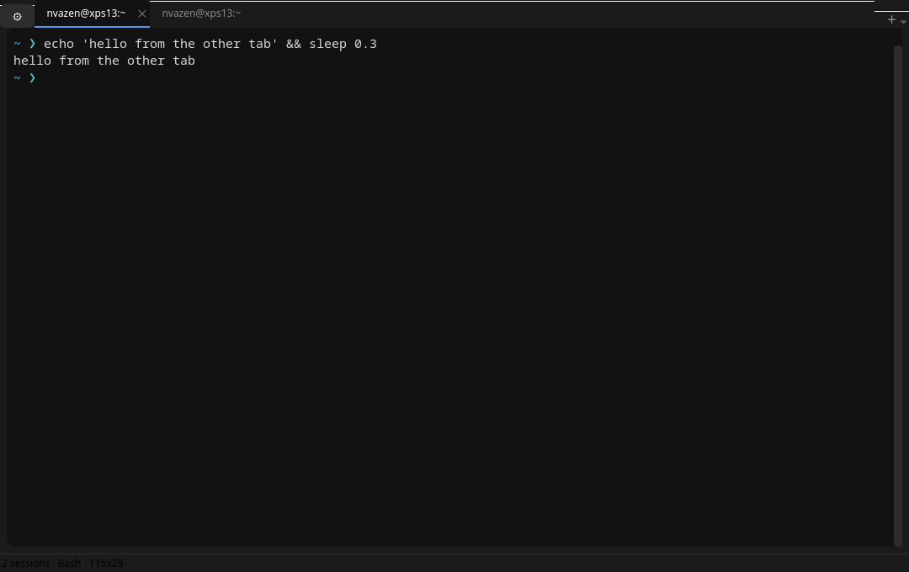

# DeepTerminal

DeepTerminal is a native Qt terminal for Linux. It runs PowerShell 7, Bash, or any
shell on a **real pseudo-terminal**, with a wide xterm-compatible screen, tabs,
scrollback, search, mouse support, IME input, and a small, hackable Python codebase.

Beta 2 is a rewrite of the terminal core. Beta 1 piped `pwsh` through
`QProcess`; Beta 2 runs the shell on a PTY and renders it with
[pyte](https://github.com/selectel/pyte), so full-screen programs, job control,
colours and resize behave like a normal terminal.

Version 2.1 adds a modern tab strip (accent underline, hover close buttons,
middle-click to close) and **styled prompts**: pick a preset (Arrow, Angled,
Minimal, Powerline, Whale, …), override the symbol and its colours, and watch a
live preview in Settings → Prompt. The prompt is injected into Bash (`PS1`) and
PowerShell (a `prompt` function) with truecolour SGR, and the setup line itself
is never echoed to the screen.

Version 2.5.1 reflows the screen and scrollback when the window is
resized, so wrapped text re-wraps at the new width instead of being clipped.



## Features

- **Real terminal**: PTY with job control (`Ctrl+C`, `Ctrl+Z`), `isatty()`,
  `stty size`, `ssh`, `sudo`, `tmux`, `vim`, `less`, `htop`.
- **Wide ANSI/xterm support** through pyte: cursor addressing, erase/insert/delete,
  scroll regions, autowrap, alternate screen, origin mode, character sets,
  16/256/true-colour SGR, bold, italic, underline, reverse, strikethrough.
- **Tabs**: per-tab shell, hover close buttons, middle-click to close,
  double-click to rename, restart, duplicate, drag to reorder.
  Tabs follow OSC 0/2 titles set by the shell (for example the current directory).
- **Styled prompts**: presets with truecolour icons (❯ ➜ 🐳), custom symbol,
  symbol/path colours, optional `username@host`, powerline segments, and a live
  preview in Settings. Applies to Bash and PowerShell; a plain `{path}` format
  string is still supported.
- **Scrollback** (configurable, default 5000 lines), mouse wheel and scrollbar.
- **Reflow on resize**: resizing the window re-wraps and re-joins wrapped lines
  in both the screen and scrollback, so no text is clipped away.
- **Search** across screen and scrollback (`Ctrl+Shift+F`) with highlight and
  next/previous navigation.
- **Selection and clipboard**: drag selection, double-click word, select all,
  copy/paste shortcuts, middle-click paste, bracketed paste, X11 primary selection.
- **Mouse reporting** for TUI programs (X10 and SGR 1006/1000/1002/1003), plus
  focus reporting; hold `Shift` to select text while an app owns the mouse.
- **IME input** with pre-edit display, so Chinese/Japanese/Korean input works.
- **Resize propagation**: the child sees `SIGWINCH` and the new grid size.
- **Settings**: sidebar dialog with General / Appearance / Prompt pages —
  shell, startup command, theme (dark/light), monospace family and size,
  scrollback, cursor blinking, start directory, prompt style designer.
- **Command line**: `--shell`, `--command`, `--working-dir`, `--version`.
- **Installer** with desktop entry, icon and `--uninstall`.

## Requirements

- Linux (X11 or Wayland; tested on KDE Wayland)
- Python 3.10+ (3.14 tested)
- PyQt6 and pyte (installed by the installer)
- PowerShell 7 (`pwsh`) and/or Bash. Other shells work through the custom command.

## Install

```bash
git clone https://github.com/AzenDev2026/DeepTerminal.git
cd DeepTerminal
bash install.sh
```

The installer creates `.venv`, installs the dependencies, and registers
`DeepTerminal` in the application menu. Launch it from there, or run:

```bash
.venv/bin/python deepter.py
```

Remove the menu entry and icon with:

```bash
bash install.sh --uninstall
```

## Shells

Set the default shell in **Settings** (⚙), or pick one from the **＋ New Tab** menu:

| Choice | Command |
|---|---|
| PowerShell 7 | `pwsh -NoLogo -NoExit -Command <prompt setup>` |
| Bash | `bash -i` |
| Custom command | anything you type, e.g. `fish -i`, `/bin/zsh -l`, `nu` |

The **prompt** is configured in **Settings → Prompt**. Styled presets apply to
PowerShell and Bash; the **Custom format** style uses the legacy plain string
with `{path}` for the current directory. **Shell default** leaves the shell's
own prompt untouched, and custom shells always keep their own prompt. Beta 1
settings (`prompt`, `theme`, `startup_cmd`) are preserved, and the old `terinfo`
command now lives in **＋ → About DeepTerminal**.

## Keyboard shortcuts

| Shortcut | Action |
|---|---|
| `Ctrl+Shift+T` | New tab |
| `Ctrl+W` | Close tab |
| `Ctrl+Tab` / `Ctrl+Shift+Tab` | Next / previous tab |
| `Ctrl+Shift+C` / `Ctrl+Shift+V` | Copy / paste |
| `Ctrl+Insert` / `Shift+Insert` | Copy / paste (terminal convention) |
| `Ctrl+Shift+F` | Find in terminal |
| `Ctrl+=` / `Ctrl+-` / `Ctrl+0` | Zoom in / out / reset |
| `F11` | Full screen |
| `Ctrl+,` | Settings |

Everything else is sent to the shell unchanged (`Ctrl+C`, `Ctrl+Z`, `Ctrl+D`,
function keys, arrows, …). With the alternate screen active (vim, less, htop)
the application cursor-key mode is honoured automatically.

## Settings

The dialog is organised in three pages: **General**, **Appearance** and **Prompt**.

| Setting | Meaning |
|---|---|
| Default shell | Shell used for new tabs. |
| Custom command | Executable and arguments for the custom shell choice. |
| Startup command | Typed into every new tab after the shell starts. |
| Start directory | Working directory for new shells (default: home). |
| Theme | `dark` or `light` palettes for the whole window and terminal. |
| Terminal font | Fixed-pitch family and point size. |
| Scrollback | Number of lines kept above the screen. |
| Cursor blink | Blinking block cursor. |
| Prompt style | Arrow, Angled, Minimal, Powerline, Whale, Custom format or Shell default. |
| Symbol | Override the preset's prompt icon (any emoji or character). |
| Symbol / path color | Per-segment truecolour override (preset default available). |
| username@host | Prefix the prompt with the current user and machine. |

Shell, prompt style and startup command apply to new tabs; theme, font and
blinking apply immediately.

## Known limits

- No sixel or kitty graphics protocol, and no inline images.
- No shell integration (OSC 7 current directory) or clickable hyperlinks yet.
- Mouse reporting supports X10 and SGR (1000/1002/1003/1006), not 1005/1015.
- Search is single-line and capped at 5000 matches.
- Selection/search anchors can drift if new output arrives while you interact
  with scrollback; the viewport itself stays anchored.
- No split panes or session restore.
- Linux only.

## Code layout

```
deepter.py                 launcher: argument parsing, QApplication, main window
deepterminal/
  config.py                QSettings wrapper, themes, application constants
  promptstyle.py           styled prompt presets, PS1/prompt builders, preview
  shells.py                shell profiles, prompt setup, environment
  ptyproc.py               PTY + child process, SIGWINCH, output reader thread
  emulator.py              pyte screen with alternate screen, mouse modes, title
  view.py                  QPainter terminal widget: input, selection, search, IME
  find_dialog.py           non-modal find bar
  settings_dialog.py       sidebar settings dialog with the prompt designer
  window.py                tabs, shortcuts, menus, status bar
tests/smoke_test.py        headless checks (offscreen Qt, real bash PTY)
tests/make_screenshot.py   regenerates docs/screenshot.png offscreen
```

The widget paints the pyte cell grid directly, so the terminal behaves like a
native Qt control: theme tokens come from `config.py`, selection and search
highlights are painted in the same grid, and keyboard/mouse/IME events are
translated to the byte sequences a real terminal sends.

## Tests

The headless suite drives a real `bash` on a PTY and checks the emulator, key
encoding, alternate screen, colours, scrollback, selection, clipboard, search,
mouse reporting and resize:

```bash
QT_QPA_PLATFORM=offscreen .venv/bin/python tests/smoke_test.py
```

## License

GPL-3.0. See [LICENSE](LICENSE).
