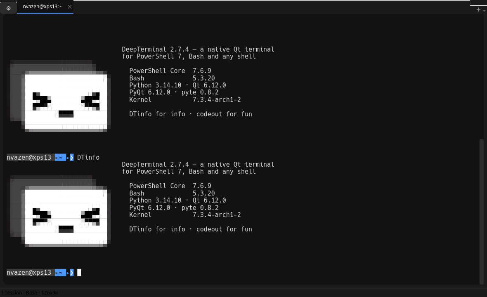
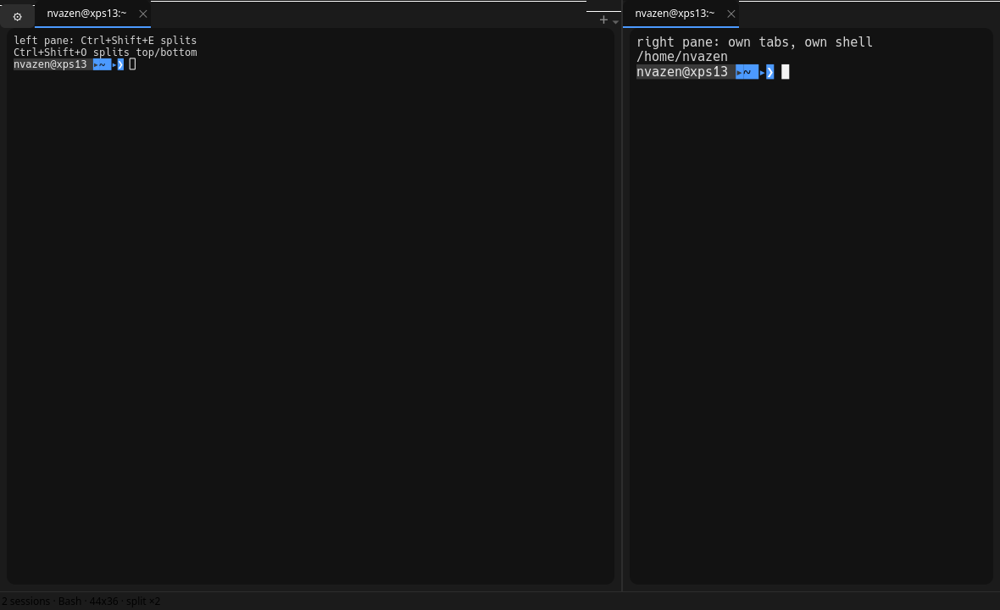
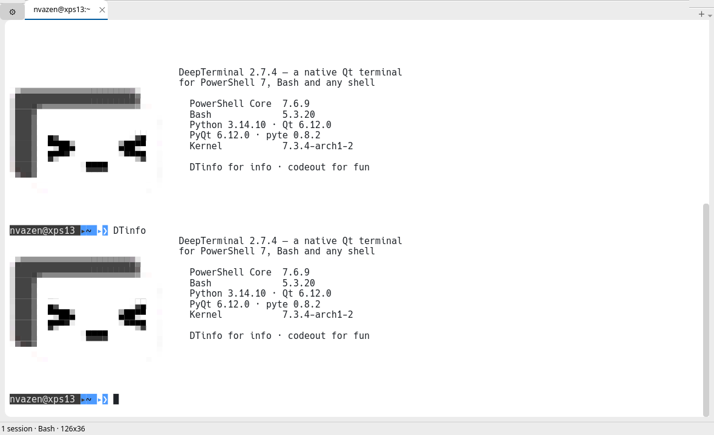

# DeepTerminal

A native **Qt terminal for Linux**: run PowerShell 7, Bash or any shell on a real
pseudo-terminal, with tabs, split view, scrollback, search, IME input, styled
prompts and a small hackable Python codebase.



## What's new — 2.7.4

- **Split view** — `Ctrl+Shift+E` puts a second terminal left/right,
  `Ctrl+Shift+O` top/bottom, Konsole style. Every pane keeps its own tabs.
- **DTinfo shows the DeepTerminal icon inline** — chafa-style coloured
  half-block art (`▀` cells, truecolour) beside the version info, the way
  sysfetch/fastfetch do it. Type `DTinfo` in any tab.
- **Styled prompts** — Arrow, Angled, Minimal, Powerline, Whale presets with
  truecolour segments and a live preview in Settings.
- **Immersive mode** — `F11` frameless fullscreen; the tab bar slides back in
  from the top edge.
- **`codeout`** — a fake system-boot flood of coloured log lines, just for fun.
- Fixes: powerline colours no longer get stripped when the launcher sets
  `NO_COLOR` (2.7.2), and DTinfo prints exactly once (2.7.3).

Full history and every past release: **[docs/README.md](docs/README.md)**.

## Screenshots

| Split view (`Ctrl+Shift+E`) | Light theme |
|---|---|
|  |  |

## Features

- **Real terminal**: PTY with job control (`Ctrl+C`, `Ctrl+Z`), `isatty()`,
  `stty size`, `ssh`, `sudo`, `tmux`, `vim`, `less`, `htop`.
- **Wide ANSI/xterm support** through pyte: cursor addressing,
  erase/insert/delete, scroll regions, autowrap, alternate screen, origin mode,
  character sets, 16/256/true-colour SGR, bold, italic, underline, reverse,
  strikethrough.
- **Tabs**: per-tab shell, hover close buttons, middle-click to close,
  double-click to rename, restart, duplicate, drag to reorder.
- **Split view**: `Ctrl+Shift+E` left/right, `Ctrl+Shift+O` top/bottom; closing
  a pane's last tab removes the pane.
- **Immersive mode** (`F11`): frameless fullscreen, chrome hidden, reveal the
  tabs by touching the top edge. `Shift+F11` is plain fullscreen.
- **DTinfo**: draw the app icon as inline terminal art together with the
  version info; also prints automatically in every new tab.
- **Styled prompts**: presets with truecolour icons (❯ ➜ 🐳), custom symbol and
  colours, optional `username@host`, powerline segments, live preview.
- **Scrollback** (default 5000 lines, configurable), mouse wheel and scrollbar.
- **Reflow on resize**: the screen and scrollback re-wrap instead of clipping.
- **Auto font size**: the font scales with the window (or zoom with
  `Ctrl+=` / `Ctrl+-` / `Ctrl+0`).
- **Search** across screen and scrollback (`Ctrl+Shift+F`) with highlight.
- **Selection and clipboard**: drag select, double-click word, select all,
  copy/paste, middle-click paste, bracketed paste, X11 primary selection.
- **Mouse reporting** for TUI programs (X10 and SGR 1006/1000/1002/1003),
  focus reporting; hold `Shift` to select text while an app owns the mouse.
- **IME input** with pre-edit display (Chinese/Japanese/Korean).
- **Resize propagation**: the child gets `SIGWINCH` and the new grid size.
- **Settings**: General / Appearance / Prompt pages — shell, startup command,
  theme (dark / light / pure black), font, scrollback, cursor blink, start
  directory, prompt designer.
- **Command line**: `--shell`, `--command`, `--working-dir`, `--version`.
- **`codeout` easter egg**: `codeout`, `codeout 3s fast`, `codeout super`,
  configurable via `codeout-conf.txt`.
- **Installer** with desktop entry, icon and `--uninstall`.

## Download & install

### Install from source (recommended)

```bash
git clone https://github.com/AzenDev2026/DeepTerminal.git
cd DeepTerminal
bash install.sh
```

The installer creates `.venv`, installs the dependencies and adds
**DeepTerminal** to the application menu (with icon and desktop entry).

### Run without installing

```bash
git clone https://github.com/AzenDev2026/DeepTerminal.git
cd DeepTerminal
python3 -m venv .venv && .venv/bin/pip install -r requirements.txt
.venv/bin/python deepter.py
```

### Uninstall

```bash
bash install.sh --uninstall
```

### Requirements

- Linux (X11 or Wayland; tested on KDE Wayland)
- Python 3.10+ (3.14 tested)
- PyQt6 and pyte (installed by the installer)
- PowerShell 7 (`pwsh`) and/or Bash; other shells work through the custom
  command

## Shells

Set the default shell in **Settings** (⚙), or pick one from the **＋ New Tab** menu:

| Choice | Command |
|---|---|
| PowerShell 7 | `pwsh -NoLogo -NoExit -Command <prompt setup>` |
| Bash | `bash -i` |
| Custom command | anything you type, e.g. `fish -i`, `/bin/zsh -l`, `nu` |

Styled prompts apply to PowerShell and Bash; **Shell default** leaves the
shell's own prompt untouched and custom shells always keep theirs. The
**Custom format** style supports the legacy plain string with `{path}`.

## Keyboard shortcuts

| Shortcut | Action |
|---|---|
| `Ctrl+Shift+T` | New tab |
| `Ctrl+W` | Close tab |
| `Ctrl+Tab` / `Ctrl+Shift+Tab` | Next / previous tab |
| `Ctrl+Shift+E` / `Ctrl+Shift+O` | Split view left/right / top/bottom |
| `Ctrl+Shift+C` / `Ctrl+Shift+V` | Copy / paste |
| `Ctrl+Insert` / `Shift+Insert` | Copy / paste (terminal convention) |
| `Ctrl+Shift+F` | Find in terminal |
| `Ctrl+=` / `Ctrl+-` / `Ctrl+0` | Zoom in / out / reset |
| `F11` | Immersive fullscreen (frameless, no tab bar) |
| `Shift+F11` | Plain fullscreen |
| `Ctrl+,` | Settings |

Everything else is sent to the shell unchanged (`Ctrl+C`, `Ctrl+Z`, `Ctrl+D`,
function keys, arrows, …). Alternate-screen apps (vim, less, htop) get the
application cursor-key mode automatically.

## Settings

| Setting | Meaning |
|---|---|
| Default shell | Shell used for new tabs. |
| Custom command | Executable and arguments for the custom shell choice. |
| Startup command | Typed into every new tab after the shell starts. |
| Start directory | Working directory for new shells (default: home). |
| Theme | `dark`, `light` or `pure black`. |
| Terminal font | Fixed-pitch family and point size. |
| Scrollback | Number of lines kept above the screen. |
| Cursor blink | Blinking block cursor. |
| Prompt style | Arrow, Angled, Minimal, Powerline, Whale, Custom format or Shell default. |
| Symbol / colours | Override the preset's prompt icon and truecolour segments. |
| username@host | Prefix the prompt with the current user and machine. |

Shell, prompt style and startup command apply to new tabs; theme, font and
blinking apply immediately.

## Known limits

- No sixel or kitty graphics protocol; DTinfo draws the icon as half-block
  text art instead.
- No shell integration (OSC 7 current directory) or clickable hyperlinks yet.
- Mouse reporting supports X10 and SGR (1000/1002/1003/1006), not 1005/1015.
- Search is single-line and capped at 5000 matches.
- Selection/search anchors can drift if new output arrives while you interact
  with scrollback; the viewport itself stays anchored.
- No session restore (tabs and split panes are not remembered across launches).
- Linux only.

## Development

```
deepter.py                 launcher: argument parsing, QApplication, main window
deepterminal/
  config.py                QSettings wrapper, themes, application constants
  promptstyle.py           styled prompt presets, PS1/prompt builders, preview
  art.py                   chafa-style icon art for DTinfo (half blocks)
  about.py                 DTinfo text + shell-side marker
  shells.py                shell profiles, prompt setup, environment
  ptyproc.py               PTY + child process, SIGWINCH, output reader thread
  emulator.py              pyte screen with alternate screen, mouse modes, title
  view.py                  QPainter terminal widget: input, selection, search, IME
  find_dialog.py           non-modal find bar
  settings_dialog.py       sidebar settings dialog with the prompt designer
  window.py                split view, tabs, shortcuts, menus, status bar
tests/smoke_test.py        headless checks (offscreen Qt, real bash PTY)
tests/make_screenshot.py   regenerates docs/pic/screenshot.png offscreen
```

The widget paints the pyte cell grid directly, so the terminal behaves like a
native Qt control: theme tokens come from `config.py`, selection and search
highlights are painted in the same grid, and keyboard/mouse/IME events are
translated to the byte sequences a real terminal sends.

## Tests

The headless suite drives a real `bash` on a PTY and checks the emulator, key
encoding, alternate screen, colours, scrollback, selection, clipboard, search,
mouse reporting, split view, DTinfo art and resize:

```bash
QT_QPA_PLATFORM=offscreen .venv/bin/python tests/smoke_test.py
```

## License

GPL-3.0. See [LICENSE](LICENSE).
