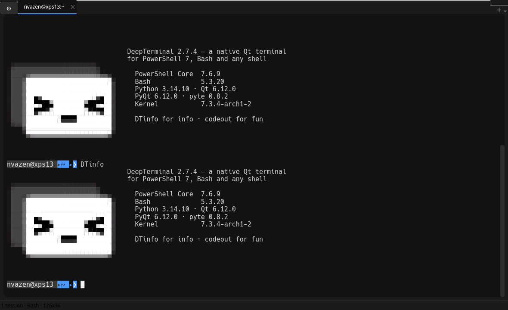
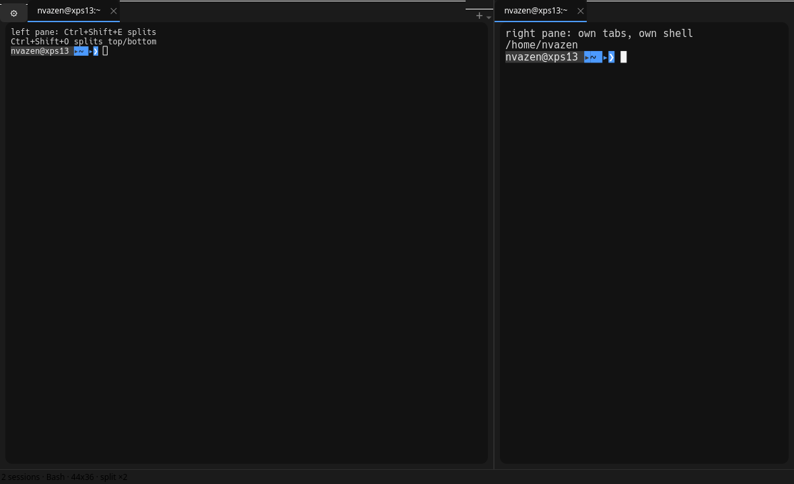
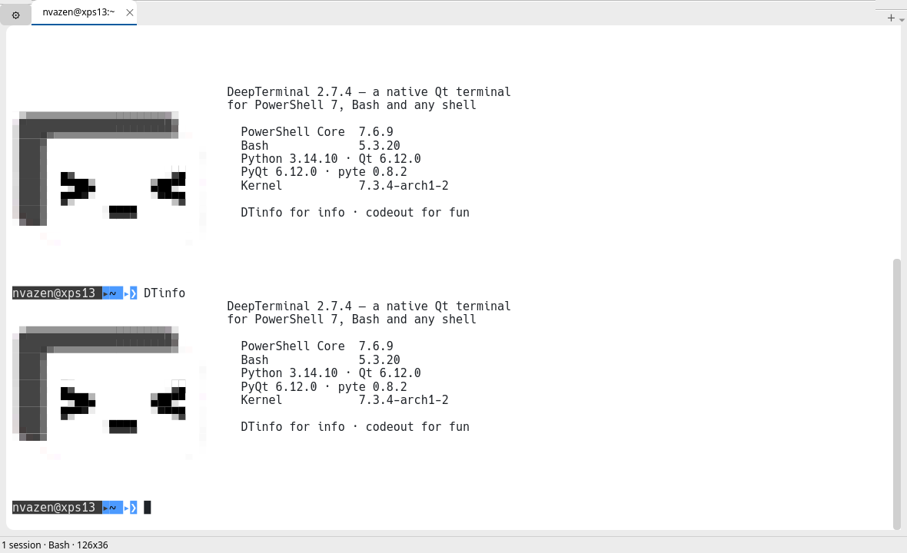

# DeepTerminal — Release History

Every release and what changed in it. The main project page lives in
[../README.md](../README.md).

## Contents

- [2.7.x](#27x)
  - [2.7.4](#274--2026-11-23)
  - [2.7.3](#273--2026-11-23)
  - [2.7.2](#272--2026-11-23)
  - [2.7.0](#270--2026-11-23)
- [2.6.x](#26x)
  - [2.6.7](#267--2026-11-22)
  - [2.6.6](#266--2026-11-22)
  - [2.6.5](#265--2026-11-21)
  - [2.6.1](#261--2026-11-21)
  - [2.6.0](#260--2026-11-20)
- [2.5.x](#25x)
  - [2.5.1](#251)
- [2.1](#21)
- [Beta 2 and Beta 1](#beta-2-and-beta-1)
- [Screenshots](#screenshots)

## 2.7.x

### 2.7.4 — 2026-11-23

- **DTinfo now draws the icon as chafa-style inline terminal art**: the app
  icon (`deepterm.png`) is rendered straight into the terminal with half-block
  characters (`▀`, upper pixel as foreground, lower pixel as background,
  truecolour). Contrast is lifted from the icon's own luminance range, so it
  stays readable on dark and light themes. The version info sits on the right
  (fastfetch/sysfetch layout) and gains a Kernel line. The floating image
  banner is gone.
- New `art.py` module and rendering tests.
- The art adapts to the window width: 28×14 cells on wide tabs, 20×10 on
  medium ones, and info-only in very narrow split panes.

### 2.7.3 — 2026-11-23

- Fixed **DTinfo printing twice**: the marker scanner matched the oscillator
  marker but never consumed the matched bytes, so the next output chunk
  matched it again. Matched bytes are now consumed (same fix for `codeout`),
  with regression tests.

### 2.7.2 — 2026-11-23

- Fixed **colourless powerline prompts**: when the launch environment contains
  `NO_COLOR` (some launchers and CI-like contexts set it), PowerShell 7.2+
  switches `$PSStyle.OutputRendering` to `PlainText` and silently strips every
  ANSI sequence from the prompt. DeepTerminal now removes `NO_COLOR` /
  `CLICOLOR` for the shell it starts, so truecolour prompts look as designed.

### 2.7.0 — 2026-11-23

- New **split view**: `Ctrl+Shift+E` splits left/right, `Ctrl+Shift+O` splits
  top/bottom (Konsole style). Every pane keeps its own tabs; closing a pane's
  last tab removes the pane.
- **DTinfo is no longer a character box**: the shell side only prints an
  invisible OSC marker and DeepTerminal renders the icon and version info
  client-side.

## 2.6.x

### 2.6.7 — 2026-11-22

- `codeout` polish: tags use only four colours — vivid red errors, bright green
  successes, orange loading, bright white for everything else — and the stream
  mixes in longer kernel-log style lines (paths, timestamps, hex addresses) so
  it reads like a real boot console.

### 2.6.6 — 2026-11-22

- New **immersive mode**: press `F11` for a frameless fullscreen terminal with
  no tab bar and no status bar. Move the mouse to the very top edge to reveal
  the tabs; `F11` again exits. `Shift+F11` keeps the old plain fullscreen.
- The Appearance page gains a **Pure Black** theme: the same dark palette with a
  true `#000000` background.

### 2.6.5 — 2026-11-21

- New **`codeout`** easter egg: type `codeout` in a Bash or PowerShell tab and
  the screen floods with a fake "system boot" log
  (`[successful]eating a pizza`, `[error]dont want to go to school`,
  `[loading]system DeepTerminal`, …).
- Tune it with `codeout 3s`, `codeout fast`, `codeout super`,
  `codeout 3s super`. Every 60 lines the oldest 30 are cleaned up so the flood
  never piles up. Defaults live in
  `~/.config/AzenDev/DeepTerminal/codeout-conf.txt`:

  ```
  #code output config
  #just for fun
  [time]:3s
  [speed]:super
  ```

- `codeout stop` ends the show, `codeout conf` prints the config path.

### 2.6.1 — 2026-11-21

- Fixed the garbled banner on first open (it now renders line-aligned instead of
  drifting right).
- Runs `clear` automatically each time a Bash or PowerShell tab opens
  (toggle in Settings → General).
- The prompt stays in place instead of sinking when the window grows.

### 2.6.0 — 2026-11-20

- Resizing the window no longer clears the screen (reflow only).
- New **auto font size**: the font scales with the window area (6–32 pt,
  toggle in Settings → Appearance).
- Every new tab shows an **About DeepTerminal** banner.
- The in-terminal about command is back: type **`DTinfo`** in a Bash or
  PowerShell tab.

## 2.5.x

### 2.5.1

- Resizing the window re-wraps the screen and scrollback at the new width
  instead of clipping text.

## 2.1

- Modern tab strip (accent underline, hover close buttons, middle-click close).
- **Customisable prompts**: presets (Arrow, Angled, Minimal, Powerline,
  Whale, …), custom symbol and colours, live preview in Settings. The prompt is
  injected into Bash (`PS1`) and PowerShell (a `prompt` function) with
  truecolour SGR, and the injected setup line itself is never echoed.

## Beta 2 and Beta 1

Beta 2 rewrote the terminal core: Beta 1 piped `pwsh` through `QProcess`;
Beta 2 runs the shell on a real PTY and renders it with
[pyte](https://github.com/selectel/pyte), so full-screen programs, job
control, colours and window resizing behave like a normal terminal.

## Screenshots

| Dark theme / DTinfo art | Split view | Light theme |
|---|---|---|
|  |  |  |

Everything lives in [`pic/`](pic/). Regenerate the main screenshot with:

```bash
QT_QPA_PLATFORM=offscreen .venv/bin/python tests/make_screenshot.py
```
